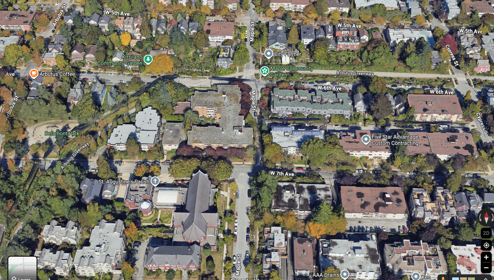
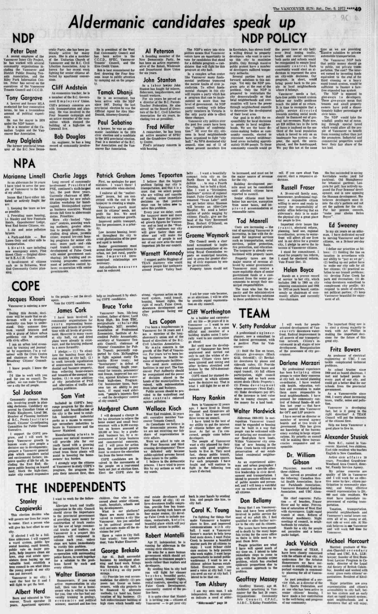
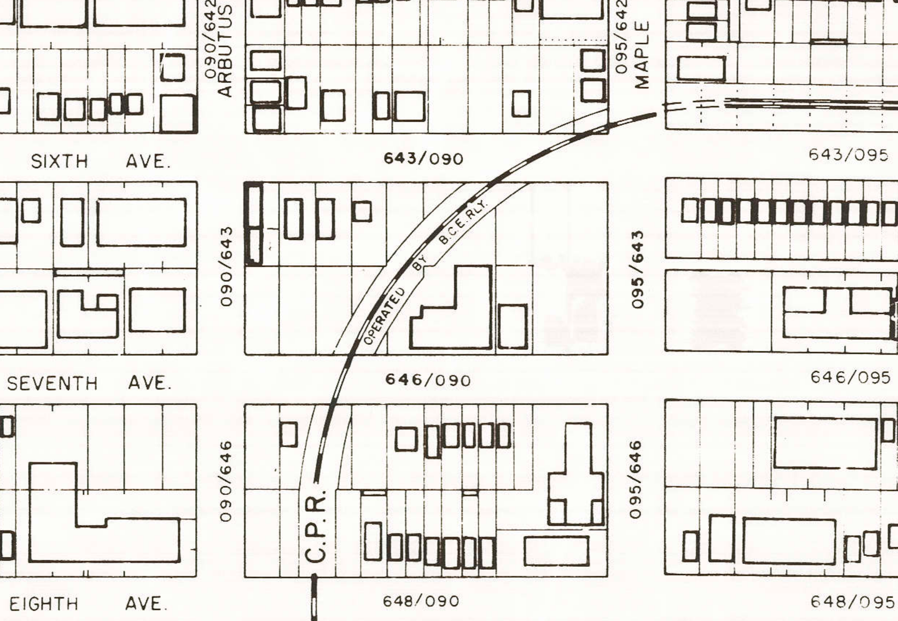
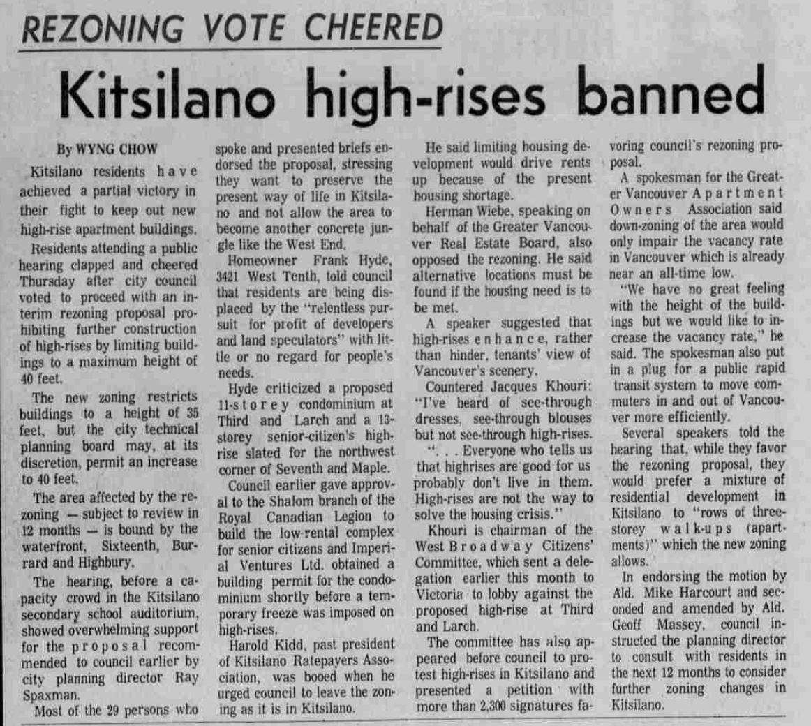
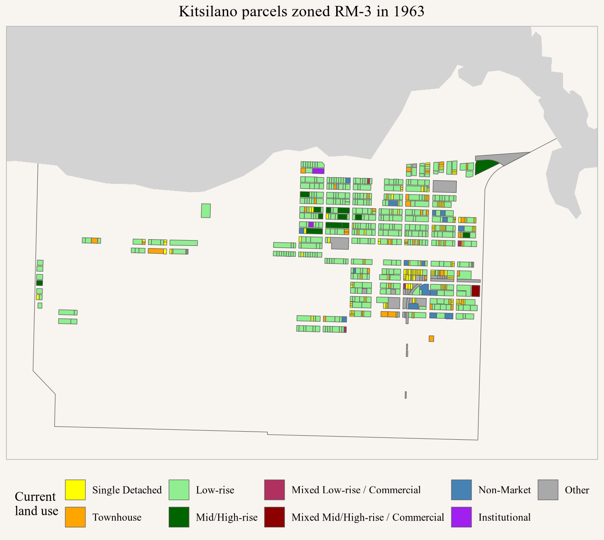
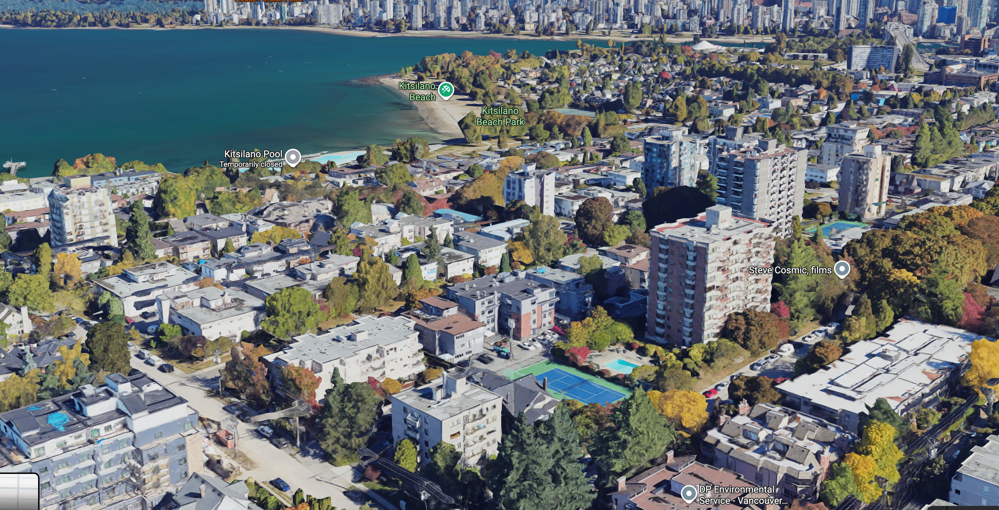
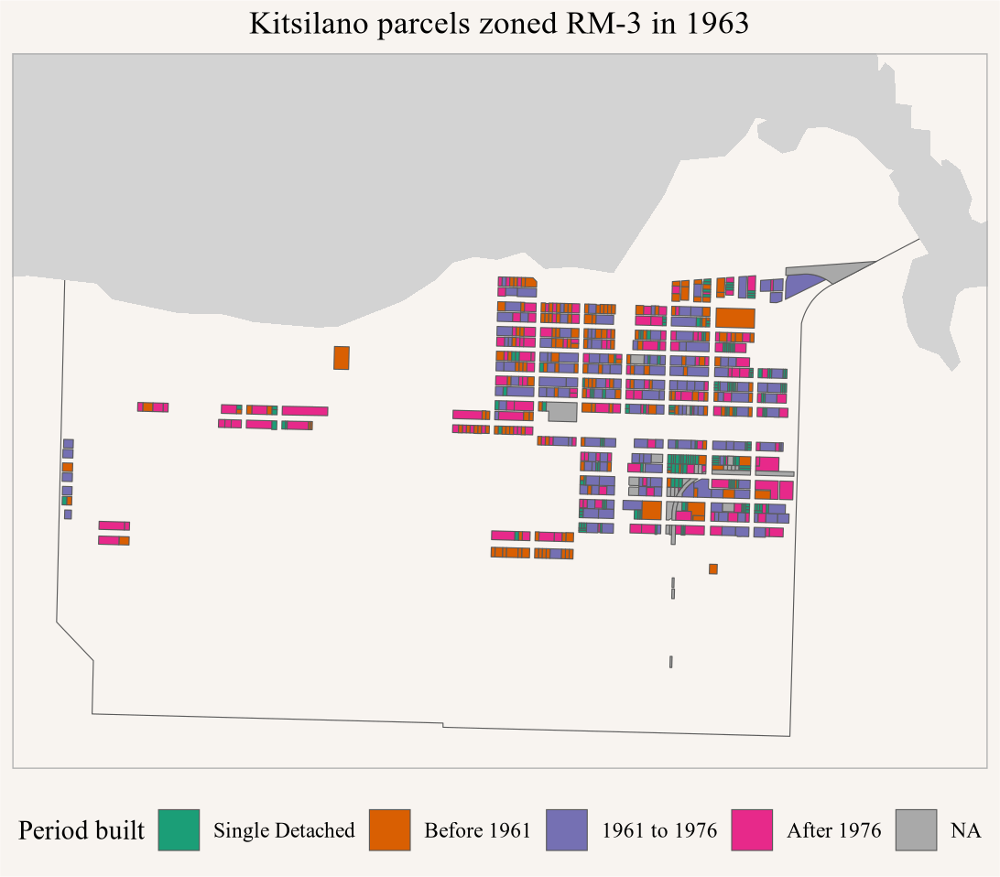
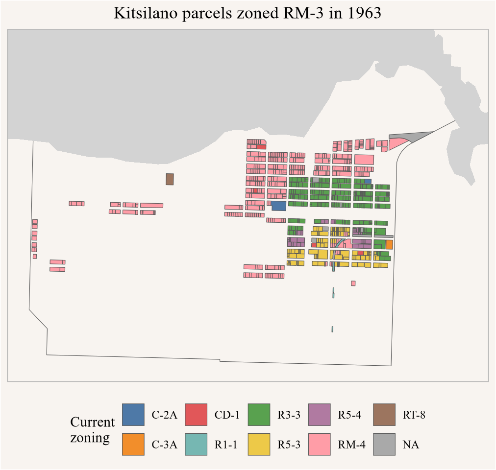

<p style="text-align:center;"><i>(Joint with Nathan Lauster and cross-posted at <a href="https://homefreesociology.com/2026/10/17/counterfactual-kitsilano/" target="_blank">HomeFreeSociology</a>)</i></p>

```{=html}
<style>
.img_left {
  float: left;
  margin-right:10px;
  margin-bottom:-10px;
  width: 50%;
  min_width: 300px;
}
.img_right {
  float: right;
  margin-left:10px;
  width: 50%;
  margin-bottom:-10px;
  min_width: 300px;
}
</style>
```


There are fun little mysteries all over Vancouver. Like how come Maple Street disappears between 6th and 7th Ave in Kitsilano? And why don't we have enough housing where people want to live?

**As it turns out, these two particular mysteries are connected!**

To figure out why, we have to travel back in time to the 1960s and 70s. 

First, to ground the discussion, here's what Maple Street looks like now between 6th and 7th Ave. It stops, then starts up again on the other side.

:::{.img_left}

:::

To explain the break in Maple Street, we begin our story a couple of decades prior. In 1956, Vancouver modernized its zoning bylaw ([Bylaw 3575](https://bylaws.vancouver.ca/consolidated/3575.PDF)), enabling the rise of apartment towers across the West End. After studies and further consideration of demand for apartment towers, the formerly [low-rise RM-3 schedule](https://bylaws.vancouver.ca/consolidated/3575.PDF#page=51) was upzoned in 1961 to enable their spread elsewhere across the City ([Bylaw 3926, s.8](https://bylaws.vancouver.ca/consolidated/3926.PDF#page=3)). So it was that towers began showing up in places like Fairview, Kerrisdale, and Kitsilano. In an attempt to learn lessons from West End development, the new RM-3 schedule encouraged a slim "tower in a park" form, lifting maximum heights and providing extra floor space in relation to lot size for underground parking, large lots, and small building footprints. 

The rise of apartment towers provoked a backlash. The first flashpoint came with the proposal of a ten storey tower in the RM-3 zone across from Kitsilano Beach on the 2200 block of Cornwall. Protesters mobilized, drawing heavily from the community of former hippies and the hippie-adjacent, gradually settling into careers in the area. Protesters were clear they sought to prevent Kitsilano from becoming like the West End. Developer Ben Wosk was not especially engaged in the project and backed off in exchange for the City providing him density elsewhere *and* forbidding anyone else from building towers close to the beach. So the RM-3A zone ([Bylaw 4625](https://bylaws.vancouver.ca/consolidated/4625.PDF)) was established in June of 1972, while the historically dominant Non-Partisan Association (NPA) still controlled the Council, all in an intent to a) mollify the protesters, b) protect the beach environment, and c) safeguard the deal with the developer.

**The protesters would not be mollified.**

The election in December of 1972 brought further expansion of the anti-tower backlash. NPA Mayor Tom Campbell, himself a developer, declined to run again, and his initial replacement, Bill Street, would also drop out over ties to development, vacating the political field. Only two former NPA aldermen ran for re-election, with Marianne Linnell the sole candidate to win a seat. A centrist party of reformist professionals, TEAM (The Electors' Action Movement), was best positioned to pick up former NPA supporters, especially given a left divided between COPE (Committee Of Progressive Electors) and municipal candidates from the NDP. 

:::{.img_right}

:::

Candidate statements printed in The Vancouver Sun (Dec 9, 1972, p. 49) widely highlight anger against developers. They also point toward how TEAM's biggest promise was support for preserving quiet residential neighbourhoods and more community consultation. Meanwhile some of the biggest anti-tower protest organizers (e.g. Bruce Yorke) ran for COPE. The new council would see a TEAM majority, and immediately proceeded with efforts to slow down a variety of developments (many ultimately quixotic insofar as developers already had building permits in hand). 

The first rezoning priority for the TEAM council was the West End itself, which they immediately downzoned after they took office in January of 1973 ([Bylaw 4683](https://bylaws.vancouver.ca/consolidated/4683.pdf)), setting up a new RM-4A zone. Shortly thereafter this would be shifted again to WED. Meanwhile, uphill from the beach in Kitsilano, the protest coalitions found new targets in a private apartment tower proposed to replace seven houses (many subdivided) on the 2400 block of W. 3rd Avenue, and another tower proposed by the Shalom branch of the Royal Canadian Legion as non-profit senior's housing on W. 7th and Maple. TEAM obliged the protesters in February of 1974 by downzoning all of Kitsilano's remaining RM-3 districts to match them to the new RM-3A district first created for the beach area ([Bylaw 4757](https://bylaws.vancouver.ca/consolidated/4757.pdf)).

**The protesters would not be mollified.**

:::{.img_left}
)](images/kits-last-midrisde-bulldozer.jpg)
:::

The immediate problem was that both the proposed towers being protested effectively already had their permissions in hand. For the W. 3rd tower, this meant they were able to ignore the protesters, replacing the seven old houses with 64 new units constructed at the [Carriage House](https://www.rew.ca/buildings/8074/carriage-house-vancouver-bc). For the W. 7th Senior's Housing project, things became more dicey. The big issue was the Canadian Legion's attempt to get public funding to assist in the project. 

The W. 7th project (often referred to by cross-street as 2229 Maple St) had already been the subject of contentious City Council meetings starting in 1973. It was one of the first proposals subject to the new Urban Design Panel set in place as part of more discretionary planning advocated by TEAM and their new planner, Ray Spaxman. The Design Panel argued the tower risked reducing public amenity since it was out of character with surrounding three-story buildings. The Technical Planning Board did not believe this was an actionable reason for them to reject the application given the project fit with the RM-3 zoning still in place at the time, so they referred the project to Council. Activist groups including the Kitsilano Citizen's Committee and the West Broadway Citizen's Committee strenuously opposed approval, and succeeded in delaying the Council vote. The Technical Planning Board, meanwhile, noted in their appended technical report that this was precisely where their old apartment studies suggested new apartment towers should go. ([Aug 28, 1973 Council Minutes, p. 67 for Technical Report](https://searcharchives.vancouver.ca/uploads/r/null/8/c/8ced33b3e3e00f1283a46b4dce6dba63e785c1d54f1283244f30e44ed1f96c50/b5626de6-e284-413c-9e3d-0850ef21bfa8-1973-08-28.pdf#page=19))

As Council reconvened on Sep 11, 1973, they received a large petition indicating seniors' support of the project from the Golden Age Club of Vancouver. Nevertheless, Council remained split, with Alderman Hardwick ultimately putting forward a motion to approve the tower, joined by half of TEAM and the sole NPA alderman (Linnell), evenly balanced against the other half of TEAM and the sole COPE alderman (Rankin). Though it was voted down, Alderman Linnell also put forward a motion to hear more about the possibility discussed of shutting down Maple Street to support the site.  ([Sep 11, 1973 Council Minutes](https://searcharchives.vancouver.ca/uploads/r/null/8/d/8d161782de90d62252fdf2edebe835bee5c90b14576e45c7fab60860d3923eef/eb19651e-318a-472c-a8e3-be835455afc9-1973-09-11.pdf#page=14)). Alderman Linnell would purportedly criticize her fellow alderman for "talking a lot about housing, but doing little" over the matter (The Province, Sep 19, 1973, p. 27). Once again, Council deferred the decision to the next meeting. There Hardwick brought the mayor, Art Phillips, on board to finally pass a motion enabling the Technical Planning Board to approve the tower as an allowed use under RM-3.  ([Sep 18, 1973 Council Minutes](https://searcharchives.vancouver.ca/uploads/r/null/8/a/8a6d3174b671dde21b55011529d4cacd5f0a00331f556347be34cc2300f99c88/7dc42aff-20ed-448f-acf9-e466df440768-1973-09-18.pdf#page=4)).

**The protesters would not be mollified.**

Under the West Broadway Citizen's Committee, they took their protests to the CMHC, then a funding partner for the project, bringing along 45 senior citizens opposed to the project. More consequentially, they also took their protests to the Province, where special appointed advisor on housing, Michael Audain, agreed to work with them on reducing the height of the building (Vancouver Sun, Mar 8, 1974, p. 7). Under Jacques Khouri, the WBCC would also return to City Council to object, once again, to the Legion's minor request to change the funding under which the project had initially obtained a sales agreement for a portion of the land (from the Elderly Citizen's Housing Act to the National Housing Act, see [Mar 12, 1974 Council Minutes](https://searcharchives.vancouver.ca/uploads/r/null/3/3/3363d15fa1da163937526ddb176651b36ad283d0e31fdff51d8ab145a964233d/eb1c6953-56f6-4b91-ac96-b205d2172f43-1974-03-12.pdf#page=2)).

For their part, the Royal Canadian Legion argued that protesters were ill-informed, and that building a tower on the site provided room for them to comfortably house seniors while also providing a variety of ground level amenities, including "gardens, a picnic area, a putting green, and a checkerboard square" (Vancouver Sun, Oct 24, 1973, p. 52). Under the FSR constraints on RM-3, it would also appear they simply could not fit all of the 100 units they had proposed into a low-rise building on the site. The Province eventually stepped in offering a grant to cover one-third of the project's costs, lowering its ultimate asking rents, in exchange for switching to a low-rise on an expanded site able to accommodate the proposed units. How would the site be expanded? 

:::{.img_right}

:::

A convenient City of Vancouver Building Outlines Map from 1974 highlights the empty lot at the NW corner of 7th and Maple. The developer returned to City Council and was able to acquire the adjoining portion of Maple Street to expand the site. The City sold the Canadian Royal Legion Shalom Branch the land for $1 in 1974. The site expansion, in turn, enabled the Legion to fit in 102 units. However, nearly all of the outdoor amenities initially proposed would be lost to the bargain, leaving only a small courtyard remaining for the new low-rise design ([May 7, 1974 Council Minutes](https://searcharchives.vancouver.ca/uploads/r/null/5/b/5bd76fdcf6c4de77710f942ac76b9b0dc3ea44ac43d1cc1c38addc668f29723c/d06acb68-e9a9-4641-88cf-55a2969f2685-1974-05-07.pdf#page=18))

So that's why Maple Street disappears between 6th and 7th.

The big Kitsilano downzoning in response to the towers proposed at 3rd and 7th also helps explain why we don't have enough housing where people want to live. The downzoning meant lost floor space in a very direct sense. Where FSR bonusing for towers could reach approximately 1.85 under RM-3, the low-rise forms allowed under RM-3A could only get up to an FSR of 1.45, and they would have to cover nearly the entire lot to do it. While they were ultimately still able to get to all of the units they wanted in the low-rise form, The Royal Canadian Legion's experience actually demonstrates the impact of the downzoning. After all, they needed both provincial support and a sweetheart land deal from the City in order to make the switch from a high-rise with 100 units to a low-rise with 102 units. And they still lost all of the ground-level amenities they had initially planned.

Kitsilano's activists had an ideological opposition to towers that combined aesthetic objections with the belief they were bad for families, inappropriate for seniors, and too expensive. They didn't want Kitsilano "to become another concrete jungle like the West End." They worried about views; "I've heard of see-through dresses [and] see-through blouses, but not see-through high-rises." They suggested that towers were unlivable; "Everyone who tells us that high-rises are good for us probably doesn't live in them." And they received pushback, especially on affordability, with speakers opposed to downzoning noting "limiting housing development would drive rents up because of the present shortage." As the Vancouver Apartment Owners Association representative argued, "downzoning of the area would only impair the vacancy rate in Vancouver which is already near an all-time low" (Vancouver Sun, Feb 1, 1974, p. 29).

:::{.img_right}

:::

The vacancy rates, already near zero, had little room to get worse through the 1970s, but they did their best.

Another big concern with the downzoning was its effect on government assisted housing. The delays for the Maple Crest seniors' project foreshadowed further problems down the road. By Jan 1976, a [Status Report on Government Assisted Housing Council](https://searcharchives.vancouver.ca/uploads/r/null/3/5/3516f3fdf7d8b4f1c74ae6cfb7cbc5e48e1820bfc85a2446b5e0f09b09999023/6488885a-5470-45c2-adb2-0c33af687999-1976-02-10.pdf#page=51) made it clear that, "the prime causes of delay in securing approval for government assisted housing in Vancouver centred about rezoning and funding applications. An acute shortage of appropriately zoned land at prices acceptable to senior governments led many government assisted housing sponsors in Vancouver into the difficult situation of having to attempt to secure and upzone low density land before funding approval was granted." Oops. In March of 1976 [Bylaw 4951](https://bylaws.vancouver.ca/consolidated/4951.PDF) rolled out new RM-3B and RM-3A-1 schedules for Kitsilano's former RM-3A "apartment areas" that added in density bonusing for "senior citizen housing, handicapped housing, or units for individuals or families of low and average income," bumping the maximum FSR back up to 1.9. However, this bonusing remained a conditional use rather than outright, subject to approval by the Director of Planning, as with much subsequent zoning. (See also reference in Criterion 9 & 10 of the [1977 Kitsilano Plan](https://vancouver.ca/files/cov/kitsilano-neighbourhood-plan.pdf#page=7)) This conditional rule remaind purely hypothetical, no non-market housing getting anywhere close to 1.9 FSR was built in Kitsilano as a result of this.

The activists and allied politicians of the early 1970s left behind a legacy of contentious community consultation and persistent housing shortage, continuing to plague Vancouver today. The shortage was clearly perceivable, but at best met with a kind of magical thinking that either more clever subdivision of groovy old houses or the right mix of low-rise infill cooperatives could solve the issue. At worst, the shortage was redirected into attacks on developers and questions about how to enable the *right kind* of people to elbow their way into high demand neighbourhoods they wouldn't otherwise be able to afford. The intentions were often (if not always) good, but when mixed together with magical thinking and market skepticism, they ultimately paved our way to the housing hell we find ourselves in today.  

As a sidenote, many of the players involved in the Kitsilano downzoning and dealing over the Maple Crest Senior's Housing on 7th would ultimately go on to become developers and realtors themselves. Jacques Khouri from the WBCC would develop several cooperatives and specialize in heritage properties as a realtor. Michael Audain, brokering the deal for the Province, would go on to form [Polygon Homes](https://polyhomes.com/about/management/). 


## Counterfactual Kitsilano

Looking back 50 years, one may wonder what would have happened without the tower backlash and downzoning. Or even more ambitiously, what if Kitsilano had continued to upzone in response to demonstrable demand for apartments? After all, developers were starting to max out all the floor space they could get in new construction prior to the downzonings.


::: {.cell}

```{.r .cell-code}
library(tidyverse)
library(sf)
library(geos)
library(VancouvR)
library(ggthemes)
library(janitor)

used_crs <- 26910
zoning_years <- c(1963,1974,1976)
zoning_data_for_year <- function(year){
  paste0("https://s3.ca-central-1.amazonaws.com/mountainmath/cmhc/cov_zoning_",year,".geojson") |>
    read_sf()
}

sf_use_s2(FALSE)

fast_join_table <- function(x,y){

  hits <- st_intersects(x, y)
  n <- lengths(hits)
  
  match_j <- rep(NA_integer_, nrow(x))
  match_j[n == 1L] <- unlist(hits[n == 1L])
  
  amb <- which(n > 1L)
  if (length(amb)) {
    i <- rep(amb, n[amb])
    j <- unlist(hits[amb])
    gx <- as_geos_geometry(st_geometry(x))
    gy <- as_geos_geometry(st_geometry(y))
    a  <- geos_area(geos_intersection(gx[i], gy[j]))
    ord <- order(i, -a)
    keep <- ord[!duplicated(i[ord])]
    match_j[i[keep]] <- j[keep]
  }
  
  match_j
}

join_largest <- function(x, y, match_j, left = TRUE, suffix = c(".x", ".y")) {
  yd <- st_drop_geometry(y)

  # replicate st_join's handling of duplicated column names
  xn  <- setdiff(names(x), attr(x, "sf_column"))
  dup <- intersect(xn, names(yd))
  if (length(dup)) {
    names(x)[match(dup, names(x))]   <- paste0(dup, suffix[1])
    names(yd)[match(dup, names(yd))] <- paste0(dup, suffix[2])
  }

  out <- cbind(x, yd[match_j, , drop = FALSE])
  if (!left) out <- out[!is.na(match_j), ]
  out
}

fast_join <- function(x,y) {
  match_j <- fast_join_table(x,y)
  join_largest(x,y,match_j)
}
```
:::


::: {.cell}

```{.r .cell-code}
kitsilano <- get_cov_data("local-area-boundary", where = "name = 'Kitsilano'") |>
  st_transform(used_crs) |>
  st_make_valid()

kits_zoning_1963 <- zoning_data_for_year(1963) |>
  st_transform(used_crs) |>
  st_make_valid() |>
  st_intersection(kitsilano)

kits_zoning_1957 <- zoning_data_for_year(1957) |>
  st_transform(used_crs) |>
  st_make_valid() |>
  st_intersection(kitsilano)

kits_zoning_now <- get_cov_data("zoning-districts-and-labels") |>
  st_transform(used_crs) |>
  st_make_valid() |>
  st_intersection(kitsilano)


kits_landuse <- mountainmathHelpers::get_metro_vancouver_land_use_data(vintage="2016.v2026") |>
  st_transform(used_crs) |>
  select(LU_Code,LU_Desc=Description) |>
  st_make_valid() |>
  st_intersection(kitsilano)

non_market_housing <- VancouvR::get_cov_data("non-market-housing")

cov_year_built <- get_cov_data("property-tax-report", 
                               select = "land_coordinate,year_built, zoning_district", 
                               where = "tax_assessment_year = '2026'") |>
  summarize(across(c(year_built, zoning_district), \(x)min(x,na.rm=TRUE)),
            .by=land_coordinate)
 
kits_parcels <- get_cov_data("property-parcel-polygons") |>
  st_transform(used_crs) |>
  st_make_valid() |>
  st_intersection(kitsilano) |>
  summarise(geometry=st_union(geometry),.by=tax_coord) |>
  left_join(cov_year_built,by=c("tax_coord"="land_coordinate")) |>
  st_join(non_market_housing |> 
            select(nm_name=name,nm_operator=operator, nm_year=occupancy_year) |>
            st_transform(st_crs(kitsilano))) |>
  fast_join(kits_zoning_1963 |> select(zone_1963=z,category_1963=zc)) |>
  fast_join(kits_zoning_1957 |> select(zone_1957=z,category_1957=zc)) |>
  fast_join(kits_landuse) |>
  mutate(yb=case_when(is.na(year_built) ~ NA_character_,
                      year_built<1961 ~ "Before 1961",
                      year_built<=1976 ~ "1961 to 1976",
                      TRUE ~ "After 1976")) |>
  mutate(yb=factor(yb,levels=c("Before 1961","1961 to 1976","After 1976"))) |>
  mutate(area=st_area(geometry) |> as.numeric()) |>
  mutate(FSR_diff=case_when(yb=="After 1976" ~ 0.4*area, TRUE ~ 0))

# kits_parcels |> 
#   st_drop_geometry() |> 
#   summarize(FSR_diff=sum(FSR_diff),
#             .by=zone_1963) |>
#   arrange(-FSR_diff)
 
kits_buildings_2009 <- get_cov_data("building-footprints-2009") |>
  st_transform(used_crs) |>
  st_make_valid() |>
  st_intersection(kitsilano) |>
  fast_join(kits_parcels)
```
:::


Let's first have a look what what the Kitsilano parcels that used to be zoned RM-3 in 1963 look like now. Mid- to High-Rise towers are denoted in dark green, Low-Rise in light green, remaining Single-Detached in yellow, Townhouses in orange, Non-Market housing in blue, and a few Institutional uses, like the Point Grey Private Hospital, in purple. Of note, some of what gets classed as Mid-Rise here is actually Low-Rise, but set against a steep hillside, boosting its profile.


::: {.cell crop='true'}

```{.r .cell-code}
apartment_codes <- c( 
  "Residential - Low-rise Apartment",
  "Residential - Townhouse",
  "Residential - Mid/High-rise Apartment",
  "Mixed Residential (Low-rise Apartment) Commercial",
  "Mixed Residential (Mid/High-Rise Apartment) Commercial",
  "Residential - Institutional and Non-Market Housing"
)

nm_1976p <- kits_parcels |>
    filter(zone_1963=="RM-3",!is.na(nm_year),year_built>=1976) 

nm_fs <- kits_buildings_2009 |> filter(tax_coord %in% nm_1976p$tax_coord) |>
  mutate(storeys=floor(avght_m/3),
         single_floor_area=st_area(geometry)|>as.numeric()) |>
  st_drop_geometry() |>
  summarize(floor_space=sum(storeys*single_floor_area),
            storeys=mean(storeys),
            .by=tax_coord)

nm_fsr <- nm_1976p |> 
  select(tax_coord,nm_name,area) |> 
  st_drop_geometry() |> 
  left_join(nm_fs,by="tax_coord") |>
  mutate(FSR=floor_space/area)

kits_parcels |>
  filter(zone_1963=="RM-3") |>
  mutate(LU=case_when(!is.na(nm_year) ~ "Non-Market",
                      (LU_Desc %in% apartment_codes | 
                         LU_Desc=="Residential - Single Detached") ~ LU_Desc,
         TRUE ~ "Other")) |>
  mutate(LU= LU |> 
           gsub("Residential - ","",x=_) |>
           gsub("Rise","rise",x=_) |>
           gsub(" Residential \\(| Apartment"," ",x=_) |>
           gsub("\\) ","/ ",x=_) |>
           gsub(" *$","",x=_) |>
           gsub("Institutional and Non-Market Housing","Institutional",x=_) |> 
           factor(levels=c("Single Detached","Townhouse",
                           "Low-rise","Mid/High-rise",
                           "Mixed Low-rise / Commercial",
                           "Mixed Mid/High-rise / Commercial",
                           "Non-Market","Institutional","Other"))) |>
ggplot(aes(fill=LU)) +
  geom_sf(data=kitsilano, fill=NA) +
  geom_sf() +
  mountainmathHelpers::geom_water(fill="lightgrey") +
  coord_sf(datum=NA) +
  scale_fill_manual(values=c("Single Detached"="yellow",
                             "Townhouse"="orange",
                             "Low-rise"="lightgreen",
                             "Mid/High-rise"="darkgreen",
                             "Mixed Low-rise / Commercial"="maroon",
                             "Mixed Mid/High-rise / Commercial"="darkred",
                             "Non-Market"="steelblue",
                             "Institutional"="purple",
                             "Other"="darkgrey")) +
  theme(legend.position = "bottom") +
  labs(title="Kitsilano parcels zoned RM-3 in 1963",
       fill="Current\nland use")
```

::: {.cell-output-display}
{#fig-rm-3-current-land-use width=672}
:::
:::


Most of the old RM-3 zone is in the light green of low-rise apartments, with some townhouse forms and single family mixed in. But we can see a scattering of the mid/high-rise that made it in before the downzoning. You can see nine of these towers by playing around with Google Maps. 



We can check on this directly by exploring when those homes got built.


::: {.cell crop='true'}

```{.r .cell-code}
kits_parcels |> 
  filter(zone_1963=="RM-3") |>
  #filter(LU_Desc %in% apartment_codes | LU_Desc=="Residential - Single Detached") |>
  mutate(yb=case_when(LU_Desc=="Residential - Single Detached" ~ factor("Single Detached"), TRUE ~ yb)) |>
ggplot(aes(fill=yb)) +
  geom_sf(data=kitsilano, fill=NA) +
  geom_sf() +
  scale_fill_brewer(palette = "Dark2", na.value="darkgrey") +
  mountainmathHelpers::geom_water(fill="lightgrey") +
  coord_sf(datum=NA) +
  theme(legend.position = "bottom") +
  labs(title="Kitsilano parcels zoned RM-3 in 1963",
       fill="Period built")
```

::: {.cell-output-display}
{#fig-rm-3-period-built width=768}
:::
:::


All of the true High-Rises in Kitsilano were built in that window between 1961 and 1976 before the downzoning completed. Of note, many of the Low-Rises were also built during this era, prior to developers fully embracing the feasibility of the tower form toward the end of the era. We also looked around the scattering of non-market housing built after 1976, much of it in the non-equity cooperative model, and couldn't find any examples of projects getting up to the density promised by a conditional return to FSR of 1.9. Looks like that was more of a paper promise than anything actually made real, but we're happy to stand corrected! 

More broadly, from 1976 until 1988, the old RM-3 lots of Kitsilano remained in a state of downzoned flux, shifting into various subcategories (RM-3B, RM-3A1), with a few converting to Commercial C zoning, until the rest were all placed into the RM-4 category under effectively the same downzoned height cap and FSR limit. There they would remain until the last couple of years when the Broadway Plan hit town.

Here's what zoning looks like now.


::: {.cell crop='true'}

```{.r .cell-code}
kits_parcels |> 
  filter(zone_1963=="RM-3") |>
  mutate(zoning_district=gsub(" \\(.+","",zoning_district)) |>
ggplot(aes(fill=zoning_district)) +
  geom_sf(data=kitsilano, fill=NA) +
  geom_sf() +
  mountainmathHelpers::geom_water(fill="lightgrey") +
  coord_sf(datum=NA) +
  ggthemes::scale_fill_tableau(na.value="darkgrey") +
  theme(legend.position = "bottom") +
  labs(title="Kitsilano parcels zoned RM-3 in 1963",
       fill="Current\nzoning")
```

::: {.cell-output-display}
{#fig-rm-3-current-zoning  width=768}
:::
:::


We are making room for towers again, thanks to the Broadway Plan. A good chunk of RM-4 was recently upzoned to [R3-3](https://bylaws.vancouver.ca/zoning/zoning-by-law-district-schedule-r3.pdf) and [R5-3/4](https://bylaws.vancouver.ca/zoning/zoning-by-law-district-schedule-r5.pdf). One pocket got downzoned to RT-8, and the R1-1 is just the zoning inherited by the Arbutus Greenway parcels that got caught in the middle.

The R3-3 and R5-3/4 change is too fresh to have resulted in any new buildings, but they do reverse the 1970s downzoning in the areas where they apply and allow for higher densities than even the original RM-3, although with restrictions and with a different form. R3-3 allows buildings up to 1.6 to 2.7 FSR, depending on site characteristics. In R5-3/4 the maximum available FSR goes up to 6.8 under some conditions, including secured market rental tenure and 20% inclusionary zoning requirement.

### What could have been?


::: {.cell}

```{.r .cell-code}
sm2sf <- 10.7639
fsr_rm3_rm3a <- 0.4
efficiency=0.9

area_yb<-kits_parcels |>
  mutate(yb=case_when(LU_Desc=="Residential - Single Detached" ~ 
                        factor("Single Detached"), TRUE ~ yb)) |>
  filter(zone_1963=="RM-3") |>
  st_drop_geometry() |>
  summarise(area=sum(area),.by=yb) |>
  pivot_wider(names_from = yb,values_from = area) |>
  janitor::clean_names()
```
:::


This allows us to ask some simple questions. The 1974 downzoning that moved RM-3 to RM-3A basically removed 0.4 FSR. Since developers were already maxing out allowed floor space before the downzonings it's reasonable to assume that anything that got re-developed after 1976 would have had roughly 0.4 more FSR. Running the numbers that's 773,000ft² of foregone floorspace, or roughly 869 homes at an average of 800ft² and 90% floorspace efficiency. We could've been housing a lot more people in Kitsilano.

At the same time, if more floorspace had been available under RM-3 code, developers might have developed parcels that otherwise remained undeveloped, for example the single family or townhouse portions, resulting in more homes yet again.

At the base of the towers foregone, there would also be more land left over. This could have gone toward all the kinds of amenities initially planned for Maple Crest Senior's Housing. More broadly, permeable surfaces aid with managing run-off water, landscaped trees help with climate adaptation and increase livability, and open outdoor meeting spaces enable a greater variety of neighbourly interactions - especially valuable during pandemic times.

Moreover, the land left open during initial tower development would still be available for later redevelopment if it became feasible, without the risk of displacement currently faced by tenants of low-rise apartments taking up much more of their lot. Indeed, we've seen multiple examples of just this kind of [tower infill](https://www.urbanyvr.com/new-kerrisdale-rental-apartments/) on old RM-3 zoning code lots built out to towers, adding low-risk responsive resiliency to the housing system.

To take things further, planners working to update zoning in response to demand in the 1960s might have been allowed to continue to do so through the 1970s. Kitsilano, demonstrating high demand, might have quickly gone the way of the West End. The very same West End, in fact, that a Canadian Institute of Planners jury named the [best neighbourhood in Canada](https://www.straight.com/blogra/573411/vancouvers-west-end-named-best-neighbourhood-canada#) in 2015. Go figure. 

## Upshot

There are cool stories behind lots of the built environment we see around us, and some of them also help explain broader patterns, like Vancouver's housing shortage. The tower backlash and downzonings of the 1970s had real effects, exacerbating housing shortages in places people wanted to live. They channelled development into a [new regime](https://homefreesociology.com/2023/02/07/a-brief-history-of-vancouver-planning-development-regimes/) [@a-brief-history-of-vancouver-planning-development-regimes.2023] of stronger restrictions, spot rezoning, and discretionary approvals, often tied to heritage protection. Locally they also challenged the provision of social housing, making it harder to navigate approvals and get funding from higher levels of government. Regionally they drove many people out into the suburbs, until in many places development there, too, was shut down.

Exploring the downzoning and associated counterfactuals also highlights trade-offs between lot coverage and height. The RM-3 zoning code of the time placed a high value on land and open space, strongly encouraging developers to low lot coverage tower forms, with underground parkade contained within the footprint of the building, yielding large unbuilt space with maximum flexibility how to use it, then and in the future.

Many Kitsilano activists hated towers and the thought of becoming like the West End more than they valued open space on the Legion site. Potential residents of the Legion building faced a different trade-off, trading living on lower floors in a blockier form with fewer outside walls against living on higher floors with more light and private outdoor amenities. For the City of Vancouver, the trade-off in giving away public land (the former streetway) for $1 to satisfy the aesthetic interests of Kitsilano activists is certainly interesting.

In that sense, the trade-off for City Council was also temporal: trading away future possibilities to avoid present hassles. Hassling was very much the chief weapon of irate (but not especially representative) anti-tower activists. Lost future possibilities include the many opportunities provided by open land. But also, infill tower opportunities could have [enabled the Legion to house more seniors and expand their mission](https://www.cbc.ca/news/canada/toronto/royal-canadian-legions-housing-9.7048744). And that block of Maple street could have been turned into a public park. Or a small community centre, or any range of uses benefiting the public. Planning should mean more than focusing on the loudest voiced preferences of people in the room at the moment. It should also encompass and account for the full range of opportunities being left to people in the future.


As usual, the code for this post is [available on GitHub](https://github.com/mountainMath/mountain_doodles/blob/main/posts/2026-10-17-counterfactual-kitislano/index.qmd) for anyone to reproduce or adapt for their own purposes.


<details>

<summary>Reproducibility receipt</summary>


::: {.cell}

```{.r .cell-code}
## datetime
Sys.time()
```

::: {.cell-output .cell-output-stdout}

```
[1] "2026-10-17 12:56:12 PDT"
```


:::

```{.r .cell-code}
## repository
git2r::repository()
```

::: {.cell-output .cell-output-stdout}

```
Local:    main /Users/jens/R/mountain_doodles
Remote:   main @ origin (https://github.com/mountainMath/mountain_doodles.git)
Head:     [4da4c4c] 2026-08-20: zoning constraints and land price gradients
```


:::

```{.r .cell-code}
## Session info 
sessionInfo()
```

::: {.cell-output .cell-output-stdout}

```
R version 4.6.1 (2026-06-24)
Platform: aarch64-apple-darwin23
Running under: macOS Golden Gate 27.0.1

Matrix products: default
BLAS:   /Library/Frameworks/R.framework/Versions/4.6/Resources/lib/libRblas.0.dylib 
LAPACK: /Library/Frameworks/R.framework/Versions/4.6/Resources/lib/libRlapack.dylib;  LAPACK version 3.12.1

locale:
[1] en_US.UTF-8/en_US.UTF-8/en_US.UTF-8/C/en_US.UTF-8/en_US.UTF-8

time zone: America/Vancouver
tzcode source: internal

attached base packages:
[1] stats     graphics  grDevices utils     datasets  methods   base     

other attached packages:
 [1] janitor_2.2.1   ggthemes_7.0.0  VancouvR_0.1.11 geos_0.2.5     
 [5] sf_1.1-3        lubridate_1.9.5 forcats_1.0.1   stringr_1.6.0  
 [9] dplyr_1.2.1     purrr_1.2.2     readr_2.2.0     tidyr_1.3.2    
[13] tibble_3.3.1    ggplot2_4.0.3   tidyverse_2.0.0

loaded via a namespace (and not attached):
 [1] generics_0.1.4            class_7.3-23             
 [3] KernSmooth_2.23-26        stringi_1.8.9            
 [5] hms_1.1.4                 digest_0.6.39            
 [7] magrittr_2.0.5            evaluate_1.0.5           
 [9] grid_4.6.1                timechange_0.4.0         
[11] RColorBrewer_1.1-3        fastmap_1.2.0            
[13] jsonlite_2.0.0            e1071_1.7-17             
[15] DBI_1.3.0                 libgeos_3.11.1-3         
[17] scales_1.4.0              httr2_1.3.0              
[19] codetools_0.2-20          cli_3.6.6                
[21] rlang_1.3.0               units_1.0-1              
[23] withr_3.0.3               yaml_2.3.12              
[25] otel_0.2.0                tools_4.6.1              
[27] tzdb_0.5.0                vctrs_0.7.3              
[29] R6_2.6.1                  git2r_0.36.2             
[31] proxy_0.4-29              lifecycle_1.0.5          
[33] classInt_0.4-11           snakecase_0.11.1         
[35] htmlwidgets_1.6.4         pkgconfig_2.0.3          
[37] terra_1.9-50              pillar_1.11.1            
[39] gtable_0.3.6              Rcpp_1.1.2               
[41] glue_1.8.1                xfun_0.61                
[43] tidyselect_1.2.1          rstudioapi_0.19.0        
[45] knitr_1.52                farver_2.1.2             
[47] htmltools_0.5.9           rmarkdown_2.32           
[49] mountainmathHelpers_0.1.5 wk_0.9.5                 
[51] compiler_4.6.1            S7_0.2.2                 
```


:::
:::


</details>

### References

::: {#refs}
:::


