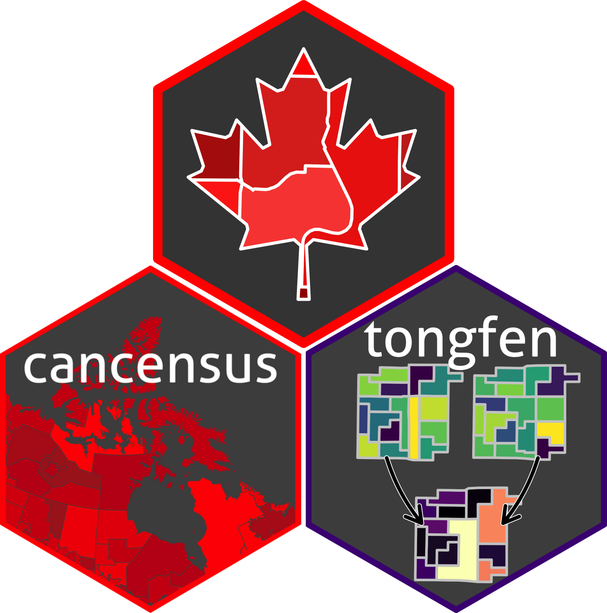

Usually we don't do posts on updates, but this is a rather large one, both for [CensusMapper](https://censusmapper.ca) as well as for [**cancensus**](https://mountainmath.github.io/cancensus/) and [**TongFen**](https://mountainmath.github.io/cancensus/). Let's start with changes common to both CensusMapper and **cancensus**:

{style="float:right;padding-left:10px;width:300px;max-width:50%;" fig-alt="CensusMapper, cancensus, and TongFen"}

## Bilingual

Both CensusMapper and **cancensus** are now bilingual. This is long overdue, but better late than never. Bilingual variable names and concepts come straight from StatCan, but other web-elements for CensusMapper or messages in **cancensus** may be a bit rough around the edges, please flag any issue you see.

What's still missing is translations of user-supplied map stories, map titles, custom variable names and labels. We have some plans to add this in the coming months.

## Older censuses

We now have data for the 1981, 1986, and 1996 in CensusMapper for mapping and **cancensus** for analysis. That's three more years of data! Unfortunately for 1981 and 1986 we have not been able to integrate Enumeration Area data because of spotty coverage of EA geographies we obtained from StatCan. We do make EA level census variables available, although their usefulness outside of TongFen is limited without the geographies. One caveat is that the 1981 census is missing some variables where our validation on data import detected problems, we are hoping to be able to add these at a later point in time. And hopefully also get full EA geographies coverage.

TongFen has also been updated and now has correspondence files covering the full range of our censuses going back to 1981, so it can be used to map fine geography changes all the way back to 1981.

## Better CMA/CA coverage

CensusMapper started out as a mapping platform, and some data that was not used in mapping was never imported. In particular, untracted CAs were not imported, and for CMAs that straddle provincial boundaries we only imported the "whole" CMA but not data for it's provincial parts. That thinking shifted with the 2021 census where we imported the full CMA/CA data, which lead to inconsistencies. There was a [long-standing issue on GitHub about this](https://github.com/mountainMath/cancensus/issues/208) and we have resolved this now by re-importing the missing data for all previous years.

To ensure that data API calls are consistent we are recalling all geographic data at the CMA level for **cancensus** users. This is not because the data of what CensusMapper served is incorrect, but because an API call now might send different data. For example, requesting CMA level data for all of Canada will now also send data for untracted CAs next to the data for CMAs and tracted CMAs it sent before.

## 2016 data issues

CensusMapper had some 2016 data that was later corrected by StatCan. We missed this. This is something we discovered during data validation on the CMA expansion mentioned above, and that is now fixed. Since the 2021 census release the CensusMapper API gained an ability to recall data that people have locally cached, and this has been integrated into the **cancensus** package. So anyone with old 2016 data using **cancensus** might get a data recall notice if they have cached data that is affected by a data correction. We have already used that on a couple of 2021 variables where StatCan issued corrections after initial release.

Unfortunately StatCan does not have a centralized way to report data corrections, and they have told us that they won't set up any mechanism where people can subscribe to data correction notices. This means that we have to constantly be on the lookout for corrections. For the 2016 data in question StatCan did post correction notice, [one on lanugage data affecting mother tongue, language spoken at home and knowledge of official languages in Quebec](https://www12.statcan.gc.ca/census-recensement/2016/ref/lang/lang-note-eng.cfm), one on selected places of birth for the immigrant population in private households, reversing male and female counts, a label swap in ethnic origin for 'Samoan' and 'Polynesian, n.o.s.', and [commute destination](https://www12.statcan.gc.ca/census-recensement/news-nouvelles/corr/cgen008-eng.cfm). Additionally there were some corrections to FSA level data that CensusMapper does not import.

Some but not all of these changes are flagged [on the Census Profile overview page](https://www150.statcan.gc.ca/n1/en/catalogue/98-316-X2016001). We apologize for not catching this earlier.

For the 2026 census release we will monitor the appropriate overview page for the 2026 census profile, but are also implementing a regular check against data changes to guard against cases where StatCan again fails to list all corrections on the overview page.

## **cancensus** specific changes

There are a couple of changes specific to **cancensus**. To access variable names or other labels in french there is a new `language` parameter in `get_census` and other functions. The default is English ("en"), but one can select French ("fr") or set the preferred default in the "cancensus.language" option.

A nice feature addition is that `get_census` has a new `labels` parameter. The default is "detailed" which results in the traditional behaviour of having data column named by internal CensusMapper vector concatenated with the variable label. Setting this to 'labelled" will return column names just being the internal CensusMapper vector with the variable label (English or French) being set as the "label" attribute of the column name. This is generally more convenient when working with the data and nicer and more expressive when plotting data, where `ggplot` picks up the labels. In the future the default will change to "labelled" and people are encouraged to set their preference in the "cancensus.labels" option.

While the main use of the package is to interact with the CensusMapper API, the package also has the ability to obtain data directly from Statistics Canada. When StatCan created the WDS endpoint specifically for querying census data we added bindings to make it easy to get data directly from StatCan.[^1] We then also added ways for people to query other related data directly from StatCan, like census geographies, GeoSuite data, and geographic attribute files.

[^1]: There are many advantages to getting data directly from an authoritative provider, but the the usefulness of that StatCan endpoint are limited. Querying data for common analysis tasks requires awkward processes, and more importantly, the endpoint is not an API. It does not have stable variable identifiers, identical calls to the endpoint at different points in time can result in querying data for different variables.

On September 28 StatCan started blocking programmatic access to all but the WDS, so this data is not available via **cancensus** any more. As a response we have taken two routes. We now self-host geographic attribute files, this restores availability via **cancensus**. We had to do this with attribute files for older census data anyway, because StatCan does not host this on their public website and it's only available via EFT. At the same time this allowed us to modernize the data format, the files are now hosted as parquet, so they come with a clear schema and also have bilingual metadata that get attached as labels.

For the census geographies we are now posting detailed instructions how to download the data manually and where to deposit it if, as currently the case, StatCan blocks programmatic downloads. In future versions we might soften this and route calls through the [safeconduct package](https://mountainmath.github.io/safeconduct/), but either way, call to census geographies will fail in any non-interactive pipeline or workflow unless StatCan unblocks this.

## TongFen

We also now self-host correspondence files for all the censuses in CensusMapper, mitigating the problem when StatCan started blocking programmatic access to these in late September. This makes it even easier to create long timelines of fine-geography census data acting as a semi-custom tabulation on the fly. One caveat is that we found what looks like typos and other mistakes in earlier correspondence files, and there is a new `links` argument in `get_tongfen_ca_census` where users can choose the original "statcan" linkage or the "adjusted" linkage where we made changes based on what we consider to be clear problems in the original StatCan correspondence data. This only makes a difference on the 1991-1986 and 1986-1981 correspondence files. This could use refinement, but it's difficult to do this without access to the 1986 and 1981 EA geographies, and we don't have a complete version of this as mentioned above.
